# Lab 6: Shaders — Solmira, Tessara y Orvane

Tres cuerpos celestes para el futuro sistema solar de fantasía, todos dibujados con la **misma esfera** (`assets/sphere.obj`, la del Canvas, sin modificar vértices) y el **software renderer en CPU**. No hay texturas ni imágenes externas: todo el color sale de los fragment shaders, con la posición del fragmento, su normal, la luz, el tiempo y ruido OpenSimplex.

| Solmira · estrella | Tessara · planeta rocoso | Orvane · gigante gaseoso |
|---|---|---|
|  | 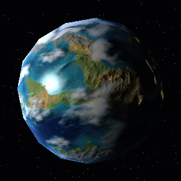 | 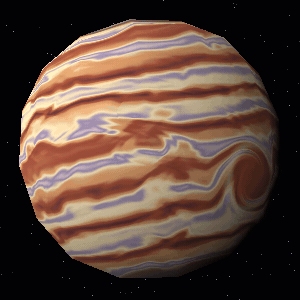 |

Extras con la misma esfera:

| Albiceleste · balón | Lumen · orbe de cristal |
|---|---|
| 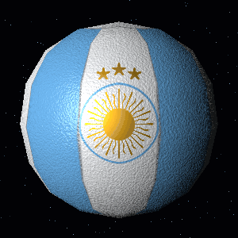 | 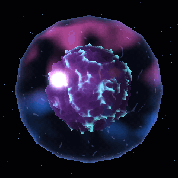 |

---

## Compilar y ejecutar

Requisitos: Rust (edición 2024) y lo que necesita raylib para compilar: CMake y un compilador de C. En Linux además `libxrandr-dev libxinerama-dev libxcursor-dev libxi-dev libgl1-mesa-dev`.

```bash
cargo run --release
```

> Usen siempre `--release`: en modo debug el ruido es mucho más lento.

### Controles

| Tecla | Acción |
|---|---|
| **1 / 2 / 3** | Estrella / planeta rocoso / gigante gaseoso (cada uno con su propio encuadre de cámara y luz) |
| **4 / 5** | Extras: balón albiceleste / orbe de cristal |
| Espacio | Pausar el tiempo |
| R | Activar / desactivar el giro de la esfera |
| L | La luz da vueltas sola · **Q / E** mover la luz a mano |
| Flechas | Orbitar la cámara · **W / S** o rueda: acercar / alejar |
| H | Resolución completa o media (más FPS) |
| K | Guardar captura PNG en `screenshots/` |
| **Estrella** | **O / P** cantidad de manchas · **U / I** velocidad del plasma |
| **Rocoso** | **B** relieve · **, / .** fuerza del relieve · **C** nubes · **X** sombras de nubes · **[ / ]** cobertura de nubes · **Z** brillo especular · **N** ciudades · **- / =** nivel del mar |
| **Gaseoso** | **9 / 0** fuerza de la tormenta · **T / Y** turbulencia de las bandas |
| **Balón** | **J / ;** cantidad de rayas |
| **Orbe** | **F / G** refracción del vidrio · **V / M** relieve del núcleo |

En la ventana se ven los valores actuales de cada parámetro, así se puede demostrar qué cambia al moverlos.

### Modo sin ventana (capturas y GIFs)

Todas las imágenes de este README salen del mismo programa:

```bash
cargo run --release -- capture          # todo: docs/*.png y docs/frames/*
cargo run --release -- capture sombras  # solo las capturas cuyo nombre contiene "sombras"
bash tools/make_gifs.sh                 # convierte los cuadros en GIFs (necesita ffmpeg)
```

Los escenarios de cada captura (tiempo, cámara, luz y parámetros) están en `src/capture.rs`.

---

## Arquitectura

| Archivo | Contenido |
|---|---|
| `src/main.rs` | Ventana de raylib, teclado, bucle principal y textos en pantalla |
| `src/pipeline.rs` | `vertex_shader` y `render`: rasterizado, depth test y fragment shader |
| `src/triangle.rs` | Rasterizado con baricéntricas y perspectiva correcta |
| `src/framebuffer.rs` | Colores, profundidad, fondo estrellado y guardado en PNG |
| `src/obj.rs` | Cargador `.obj` (v / vt / vn), centra la esfera y la deja de radio 1 |
| `src/math.rs` | Matrices 4x4, cámara, perspectiva y rotaciones (incluida Rodrigues) |
| `src/uniforms.rs` | `Uniforms` y `Params` (los parámetros que se mueven con el teclado) |
| `src/scene.rs` | Cámara orbital, luz y el encuadre propio de cada cuerpo |
| `src/capture.rs` | Modo `capture` que genera las imágenes del README |
| `src/shaders/mod.rs` | `fragment_shader`, `mix`, `smoothstep`, `ramp` (degradados) |
| `src/shaders/noise_helpers.rs` | `sample`, `sample4` (ruido 4D), `fbm`, `fbm4`, `ridged` |
| `src/shaders/{star,rocky,gas_giant}.rs` | Un shader por cuerpo celeste |
| `src/shaders/{ball,orb}.rs` | Los dos extras |

**Pipeline:** vértices → vertex shader → rasterizado con z-buffer (se guarda solo el fragmento más cercano de cada píxel) → fragment shader una vez por píxel visible, repartido en hilos con `rayon`. Así los shaders con mucho ruido no se calculan para fragmentos que luego quedan tapados.

**Sobre la esfera:** la `sphere.obj` del Canvas tiene 192 triángulos con normales planas por cara. Si se usan esas normales la luz se ve en facetas, por eso para iluminar se usa `normalize(posición)` (constante `SMOOTH_SPHERE_NORMALS` en `src/shaders/mod.rs`). Los patrones también usan la posición 3D normalizada en espacio del objeto, así que no hay costuras ni estiramientos en los polos. La silueta sí se ve poligonal, porque la geometría no se toca.

---

## 1. Solmira — estrella · `src/shaders/star.rs`

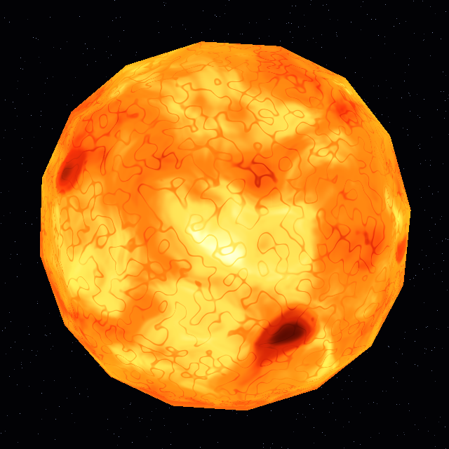

**Diseño:** una estrella naranja muy activa: plasma que hierve, celdas de convección, manchas solares y un borde más rojo y oscuro con corona. No usa la luz externa, porque ella misma es la fuente de luz.

**Patrones y cómo se combinan:**

1. **Turbulencia (calor):** fBm 4D deformado por otros tres fBm (*domain warping*). La cuarta dimensión del ruido es el tiempo, por eso el plasma cambia de forma en su lugar en vez de solo deslizarse.
2. **Granulación:** ruido de alta frecuencia; donde pasa por cero quedan canales oscuros finos, como las celdas que se ven en fotos del Sol.
3. **Manchas solares:** ruido de baja frecuencia con dos umbrales, uno para la penumbra y otro para la umbra. Solo salen en dos franjas de latitud.
4. **Borde (limb darkening):** la temperatura se multiplica por `0.55 + 0.45·sqrt(n·v)`, así el borde se ve más frío y la estrella se siente esférica sin luz.
5. **Corona:** brillo naranja con `(1 - n·v)^3`.

Todo se junta en un solo valor de *temperatura* (0 a 1) que las manchas y el borde reducen. Ese valor pasa por un degradado de 5 colores: rojo oscuro → rojo → naranja → amarillo → blanco cálido. Al final se suma la corona.

**Parámetros:** `star_activity` (O / P, cantidad de manchas), `star_speed` (U / I, velocidad del plasma), la frecuencia de granulación `p * 20.0` y las paradas del degradado.

`star_activity` 0.1 vs 0.9:

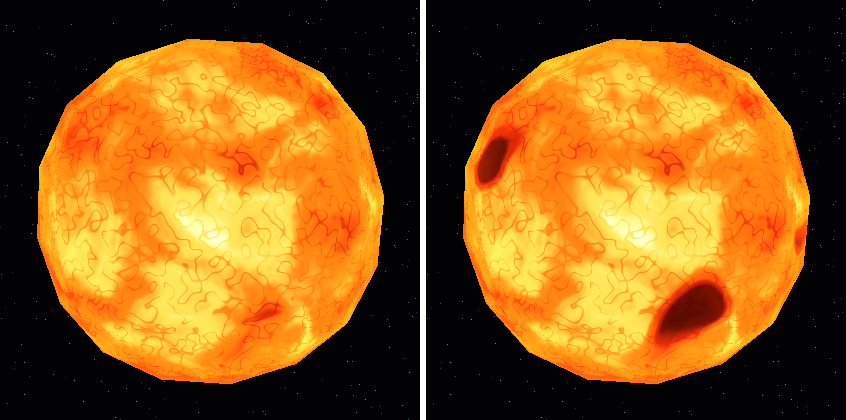

---

## 2. Tessara — planeta rocoso · `src/shaders/rocky.rs`


**Diseño:** un mundo oceánico con dos continentes grandes, desiertos ocres, praderas, bosques, cordilleras nevadas y casquetes polares. Tiene nubes que se mueven solas, sus sombras, océanos que reflejan el sol y ciudades que se encienden de noche.

**Patrones y cómo se combinan:**

1. **Continentes** (`continents`): fBm de 6 octavas deformado por otro fBm. Se compara con `sea_level`: arriba es tierra y abajo océano, con un `smoothstep` angosto en la costa.
2. **Biomas:** otro ruido da la humedad (desierto → pradera → bosque) y el frío depende de la latitud y la altura (tundra y nieve).
3. **Cordilleras:** ruido *ridged* (`1 - |ruido|`) que da crestas finas, pintadas de roca y nieve.
4. **Océano:** turquesa en la costa y azul profundo lejos de ella.
5. **Hielo polar:** `smoothstep` sobre la latitud con ruido en el borde.
6. **Iluminación por región, relieve, nubes, sombras y ciudades:** ver la tabla de efectos.

Los colores se mezclan con máscaras (`mix` + `smoothstep`): primero tierra/océano, encima el hielo. Luego se ilumina cada región a su manera, se suman las ciudades, y al final van las nubes y un halo de atmósfera azul en el borde.

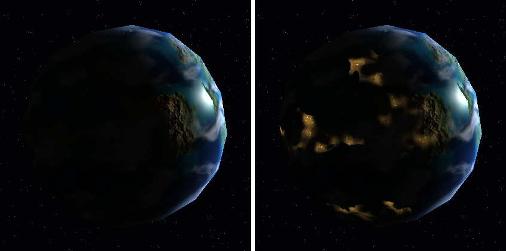

**Parámetros:** `sea_level` (- / =), `cloud_coverage` ([ / ]), `cloud_height`, `bump_strength` (, / .), y los interruptores `bump`, `clouds`, `cloud_shadows`, `specular` y `city_lights`.

---

## 3. Orvane — gigante gaseoso · `src/shaders/gas_giant.rs`

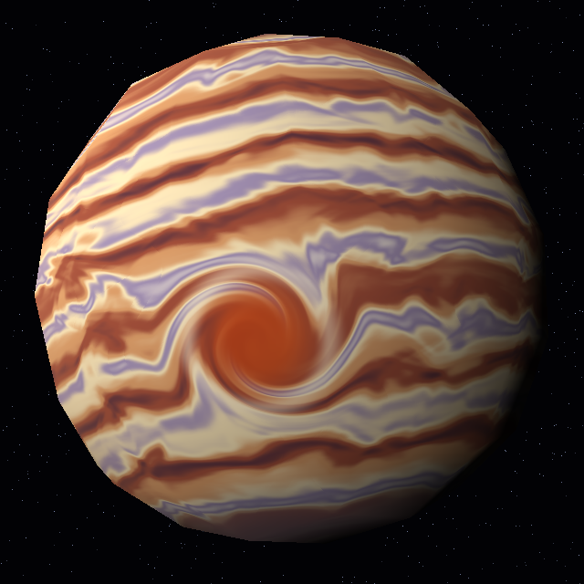

**Diseño:** bandas crema, óxido y lavanda que se mueven como líquido, con una gran tormenta rojiza en el hemisferio sur que enrosca las bandas a su alrededor.

**Patrones y cómo se combinan:**

1. **Tormenta:** el punto se gira alrededor del centro de la tormenta (Rodrigues), con un ángulo que es grande en el centro y 0 en el borde. Las bandas se calculan con ese punto ya girado, por eso se curvan.
2. **Deformación líquida:** la latitud se deforma con *domain warping* en dos pasos: un ruido `q` deforma a otro ruido `r`, y `r` deforma la latitud.
3. **Bandas** (`bands`): senos de dos frecuencias sobre la latitud deformada, más vetas finas (ruido estirado horizontalmente).
4. **Flujo animado (flow map):** cada franja de latitud se arrastra hacia un lado distinto. Para que el patrón no se estire para siempre, hay dos copias desfasadas medio ciclo que se reinician y se mezclan para ocultar el salto. El ruido además es 4D, así que también cambia de forma.
5. **Ojo y collar:** el centro se pinta rojizo con los remolinos del mismo ruido torcido y un anillo claro alrededor. Los polos se oscurecen con un tono azulado.
6. **Luz:** difusa “envuelta” (`(n·l + 0.2) / 1.2`), que suaviza la línea día/noche como una atmósfera gruesa.

**Parámetros:** `storm_strength` (9 / 0), `storm_radius`, `turbulence` (T / Y), `band_count` y `flow_speed`.

`turbulence` 0 vs 0.3:

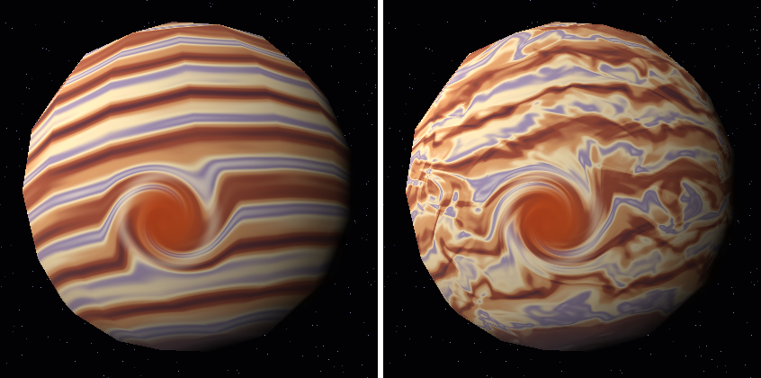

---

## Extras

Los pide el gusto, no la rúbrica: crear cuerpos adicionales no da puntos por sí solo. El orbe sí aporta un efecto nuevo (parallax).

### 4. Albiceleste — balón · `src/shaders/ball.rs`

| Frente | Atrás |
|---|---|
|  | 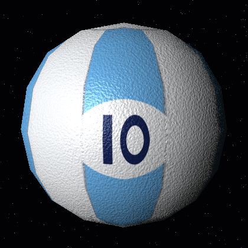 |

**Diseño:** balón con los colores de la bandera argentina: rayas celeste y blanco, el Sol de Mayo dorado, tres estrellas y el 10 en la espalda.

**Patrones y cómo se combinan:**

1. **Rayas:** `-cos(longitud · rayas / 2)` con un `smoothstep` angosto; la fase está elegida para que al frente quede el centro de una raya blanca. Los polos son tapas blancas.
2. **Costuras:** líneas grises donde el seno pasa por 0 (borde de cada raya) y un anillo alrededor de cada tapa.
3. **Figuras planas:** para el sol, las estrellas y el número se proyecta el punto al plano tangente de una dirección (`local_uv`) y se dibujan con distancias: el sol es un disco con 32 rayos (rectos y ondulados intercalados con `cos(16·ángulo)`), cada estrella es un radio que cambia con `cos(5·ángulo)`, el 1 es un rectángulo y el 0 un anillo elíptico.
4. **Material:** granito fino de ruido como bump (las costuras van hundidas). El sintético tiene un brillo suave y el dorado brilla como metal (otro exponente y color de brillo).

**Parámetros:** `ball_stripes` (J / ;), el tamaño de las estrellas en `star_mask` y la fuerza del granito `k`.

### 5. Lumen — orbe de cristal · `src/shaders/orb.rs`

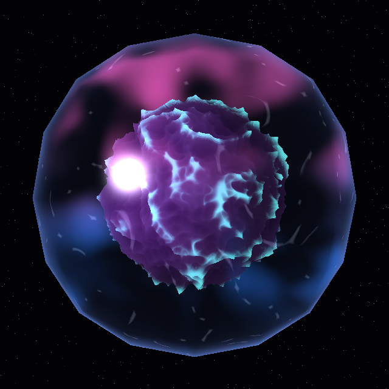

**Diseño:** una esfera de vidrio con nebulosas rosa y azul flotando adentro y un núcleo violeta con vetas que brillan.

**Patrones y cómo se combinan:**

1. **Refracción:** desde el punto de la superficie se calcula el rayo que entra al vidrio con la ley de Snell (`refract`).
2. **Ray marching:** se avanza en 24 pasos por ese rayo. En cada paso se suma un poco de nebulosa (ruido 4D, así se mueve con el tiempo) y se revisa si ya se chocó con el núcleo.
3. **Núcleo con campo de altura:** el núcleo es una esfera de radio `core_radius` levantada por un ruido ridged hasta `core_relief`. Cuando el rayo lo toca, se afina el punto con bisección y se pinta con un degradado violeta y vetas turquesa en las crestas.
4. **Vidrio:** reflejo de Fresnel en el borde, brillo especular muy concentrado y grabados finos fijos en la superficie.

**Parámetros:** `orb_ior` (F / G; con 1.0 no hay refracción), `core_relief` (V / M; con 0 el núcleo es una esfera lisa) y `core_radius`.

Sin refracción ni relieve vs normal:

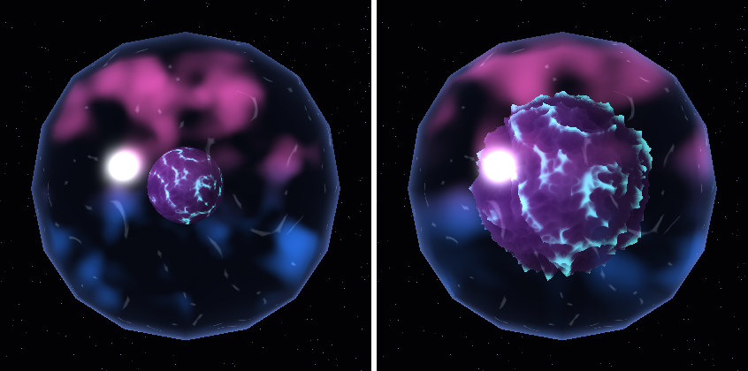

---

## Efectos solicitados

| Efecto (pts) | Cuerpo | Archivo · función | Parámetro → qué cambia |
|---|---|---|---|
| Material animado (5) | Estrella (también el gaseoso) | `star.rs` · `star()`; `noise_helpers.rs` · `sample4`, `fbm4` | `star_speed` (U / I) → qué tan rápido hierve el plasma; en 0 se congela |
| Día y noche (5) | Rocoso | `rocky.rs` · `rocky()`, sección *5. Lado nocturno* | `city_lights` (N) → las apaga; el `smoothstep(-0.12, 0.18, n·l)` de `day` → ancho del atardecer donde se encienden |
| Respuestas distintas a la luz (10) | Rocoso | `rocky.rs` · `rocky()`, sección *4. Iluminación distinta por región* | `specular` (Z); el exponente 90 del océano → tamaño del reflejo del sol (más alto = más pequeño y fuerte) |
| Nubes procedurales (10) | Rocoso | `rocky.rs` · `cloud_mask()` | `cloud_coverage` ([ / ]) → más o menos nubes; `time * 0.07` → velocidad, distinta a la del terreno |
| Tormenta / vórtice (10) | Gaseoso | `gas_giant.rs` · `gas_giant()`, sección *1. Tormenta* | `storm_strength` (9 / 0) → cuántas vueltas da la espiral; `storm_radius` → tamaño |
| Bump mapping (15) | Rocoso | `rocky.rs` · `bump_normal()` y `detail_height()` | `bump_strength` (, / .) → en 0 la tierra se ve plana, en 0.2 muy marcada |
| Sombras de nubes (20) | Rocoso | `rocky.rs` · `rocky()`, sección *3. Nubes y sus sombras* | `cloud_height` → qué tan lejos cae la sombra de su nube; `cloud_shadows` (X) → las apaga |
| Parallax dependiente de la vista (15) | Orbe (extra) | `orb.rs` · `orb()`, `core_height()`, `refract()` | `core_relief` (V / M) → profundidad del relieve del núcleo; `orb_ior` (F / G) → cuánto se desplaza el interior al mover la cámara |

**Total: 60 básicos + 90 de efectos = 150** (la nota máxima es 100).

### Material animado — Estrella

La cámara y la esfera están quietas; lo único que cambia es el material.


El tiempo es la cuarta coordenada del ruido OpenSimplex, por eso la turbulencia, las celdas y las manchas cambian de forma sin mover la geometría. En el gaseoso el flujo de bandas también es animación del material (`flow_speed`).

### Día y noche — Rocoso

La luz da una vuelta completa: del lado oscuro aparecen las ciudades. En la captura, sin ciudades vs con ciudades.

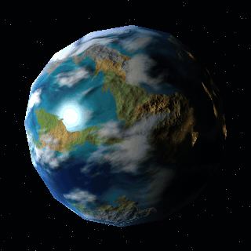


Se calcula `day = smoothstep(-0.12, 0.18, n·l)`. Las ciudades salen de ruido (tierra cerca de la costa, sin hielo ni frío extremo, con puntitos de ruido fino) y se multiplican por `1 - day`, así solo brillan de noche. Las nubes las tapan en parte.

### Respuestas distintas a la iluminación — Rocoso

Especular apagado vs encendido. En el GIF de arriba se ve cómo el reflejo recorre el mar mientras la tierra queda mate.

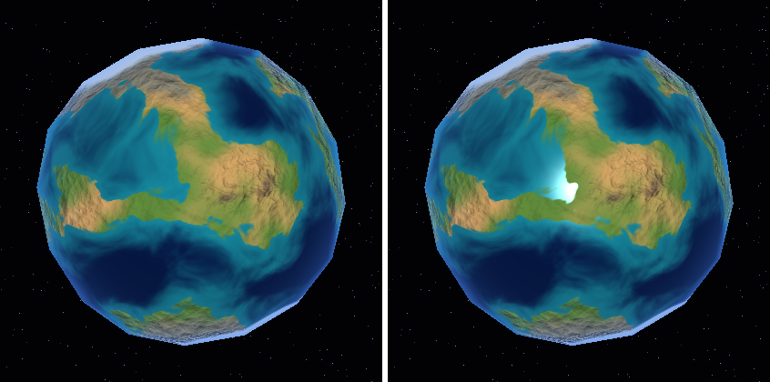

Todo recibe luz difusa, pero el brillo Blinn-Phong `(n·h)^exponente` se multiplica por máscaras: el océano tiene un reflejo fuerte y concentrado (exponente 90), el hielo uno suave y ancho (exponente 14) y la tierra ninguno.

### Nubes procedurales — Rocoso

La esfera no gira en este GIF; solo pasa el tiempo. Los continentes se quedan quietos y las nubes se mueven.


La posición se gira sobre el eje Y según el tiempo (`rotate_y(p, time * 0.07)`), así las nubes van a otro ritmo que el terreno. Un ruido de baja frecuencia las deforma en remolinos y el fBm se estira para formar frentes alargados. Es la misma esfera: la máscara se mezcla encima de la superficie con `mix`.

Cobertura 0.3 vs 0.6:

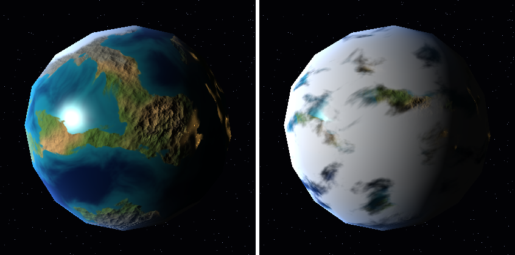

### Tormenta o vórtice localizado — Gaseoso

Fuerza 0 vs 5: sin tormenta las bandas son normales; con tormenta son las mismas bandas las que se enrollan alrededor del ojo, no un círculo pintado encima.

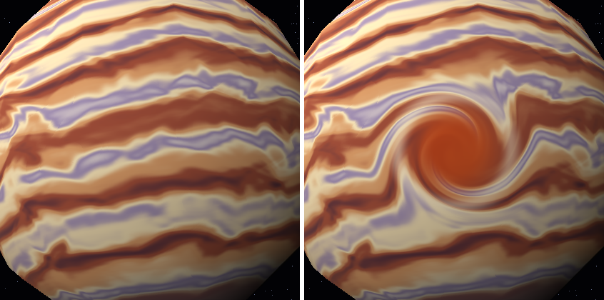

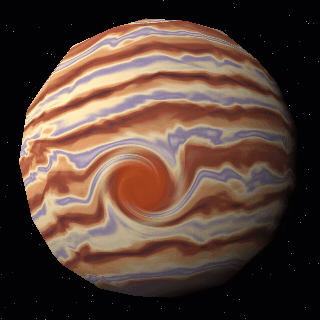

Se mide la distancia angular `d` al centro. Si está dentro del radio, el punto se gira alrededor del eje que pasa por el centro un ángulo `fuerza · (1 - d/R)²`: mucho en el centro y nada en el borde. Después se pintan el ojo y el collar.

### Relieve procedural (bump mapping) — Rocoso

Sin relieve vs con relieve, y la luz moviéndose: las sombras de las montañas cambian de lado.

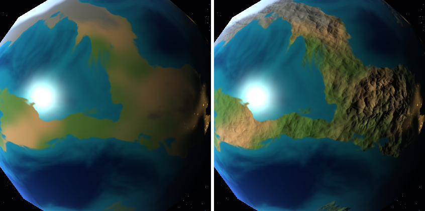

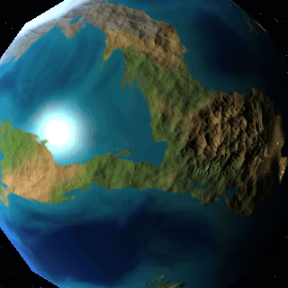

`detail_height` es un campo de altura matemático (ruido ridged + ruido fino). En cada fragmento se calcula la altura en el punto y un poquito hacia dos direcciones tangentes. Esas pendientes inclinan la normal: `n' = normalize(n - t·dh/dt·k - b·dh/db·k)`, y la luz difusa usa `n'`. Solo se aplica en tierra.

### Sombras de nubes — Rocoso

Sin sombras vs con sombras: las manchas oscuras quedan del lado contrario a la luz, al lado de cada nube. En el GIF la luz se mueve y las sombras se desplazan con ella.

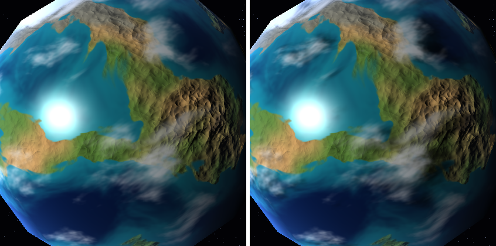

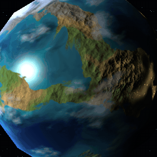

Desde el punto del suelo `p` se lanza un rayo hacia la luz `l` y se calcula dónde cruza la capa de nubes, una esfera imaginaria de radio `r = 1 + cloud_height`:
`t = -(p·l) + sqrt((p·l)² + r² - 1)`. En ese punto se evalúa la misma `cloud_mask`, y si hay nube el suelo se oscurece. Con la luz de frente la sombra queda casi debajo de la nube; cerca del atardecer se estira lejos.

### Parallax dependiente de la vista — Orbe

El tiempo está congelado y solo se mueve la cámara. Los grabados finos de la superficie se quedan pegados al vidrio, pero el núcleo y las nebulosas se desplazan distinto porque están más adentro: eso da la sensación de profundidad.

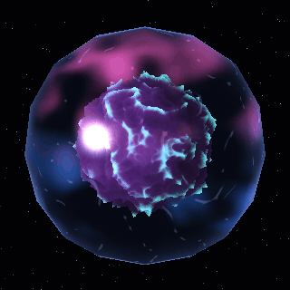

Cámara a la izquierda vs a la derecha (mismo tiempo):

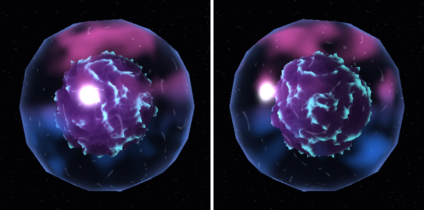

Para cada fragmento se sigue el rayo de la vista (ya refractado) hacia dentro de la esfera. El punto donde ese rayo toca el núcleo depende de la dirección de la cámara y del campo de altura procedural `core_height`, así que al mover la cámara el núcleo y su relieve se ven desde otro ángulo y se mueven respecto a la superficie. No es un patrón desplazado con el tiempo: con el tiempo en pausa el efecto sigue ahí.
